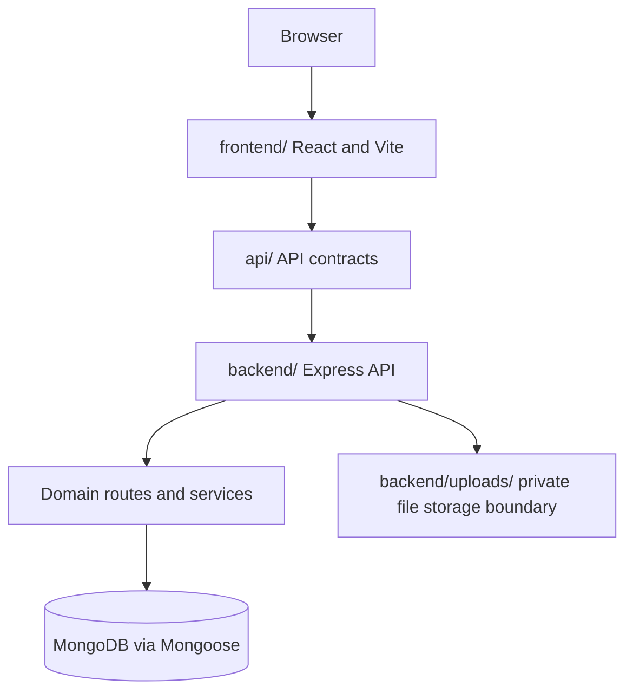

# CollegeOS

CollegeOS is a React/Vite institutional workspace backed by one Express modular monolith and one MongoDB database. It is **not currently production-ready as a multi-institution service**; see [docs/ARCHITECTURE.md](docs/ARCHITECTURE.md) for the current authorization and tenancy limitations.

## Architecture



- `frontend/`: the only browser application and its Vite configuration.
- `backend/`: the only HTTP server, authentication, domain routes, services, Mongoose models, and backend tests.
- `api/`: API ownership and contract documentation. The backend is the sole implementation.
- `docs/`: product, design, operational, and architecture documentation.
- `scripts/`: root development orchestration, the opt-in demo seed, and read-only admin utilities.
- Root `package.json` and `package-lock.json`: one npm installation shared by frontend and backend.

## Requirements

- Node.js 20 or newer
- npm
- A reachable MongoDB instance (local `mongod` is started automatically by `npm run dev`)

## Development

```powershell
npm install
npm run dev
```

The development command starts the API and Vite frontend. If the default ports (`4000` and `3000`) are occupied, it selects available ports and reports them. Open the Vite URL printed in the terminal.

The application stores its data in MongoDB at `MONGODB_URI`. It does not reset an existing bootstrap password on restart, and it provisions no institutional records beyond the single bootstrap Super Admin — every department, programme, course, section, student and finance record is entered through the application or the opt-in demo seed.

## Configuration

Copy `.env.example` to `.env` and replace placeholders as needed. `VITE_*` variables are public browser configuration only. Keep `JWT_SECRET`, bootstrap credentials, and any future mail/storage secrets on the backend and out of source control.

For production, configure a strong `JWT_SECRET` and `COLLEGEOS_BOOTSTRAP_ADMIN_PASSWORD` before first startup. The bootstrap account is `admin@<INSTITUTION_EMAIL_DOMAIN>` with the configured temporary password; it must be changed on first login.

## Checks

```powershell
npm run lint
npm run build
npm test
npm run test:api
npm run test:calendar
```

`npm run test:api` runs the integration suite against a real MongoDB-backed server on an ephemeral port, using the `collegeos_test` database (override with `COLLEGEOS_TEST_DB` and `COLLEGEOS_TEST_MONGO_HOST`). The database is dropped before and after the run, so the development data is never touched. The frontend build output is generated under `frontend/dist/` and is not maintained as source.

## Available npm scripts

| Script | Purpose |
|---|---|
| `dev` | Start API + Vite frontend (auto-starts local MongoDB) |
| `dev:client` | Vite frontend only |
| `server` | Backend only |
| `dev:server` | Backend with watch restart |
| `seed:demo` | Create missing demo fixtures (development only) |
| `seed:demo:reset` | Drop and recreate demo fixtures |
| `test` | Run all test suites |
| `test:api` | Backend API integration tests |
| `test:calendar` | Nepali calendar unit tests |
| `test:lms-format` | LMS formatting unit tests |
| `test:policy` | Password policy unit tests |
| `build` | Production frontend build |
| `preview` | Preview production build |
| `clean` | Remove build artifacts |
| `lint` | TypeScript type check |

## Current limitations

- Self-service forgot-password delivery is not configured; the reset token is stored but not emailed.
- Many dashboard/domain workflows still use frontend context state rather than the API.
- Institution-wide tenant scoping is not complete across the schema and API queries. Do not deploy this as a multi-institution service until tenant-scoped authorization and isolation tests are implemented.
- The academic calendar API is complete but the calendar workspace still renders timetable and exam data rather than calendar events.
- Object storage is not abstracted; stored files live on the local disk under `backend/uploads/` and are served only through the entitlement-checked `/api/files/:id` route.
- Google Workspace OAuth / SSO is not implemented; authentication is email/password only.
- Library circulation (borrowing, overdue fines) is not implemented despite the `library.view` permission existing.

## Documentation

See the [documentation index](docs/README.md) for all technical references.