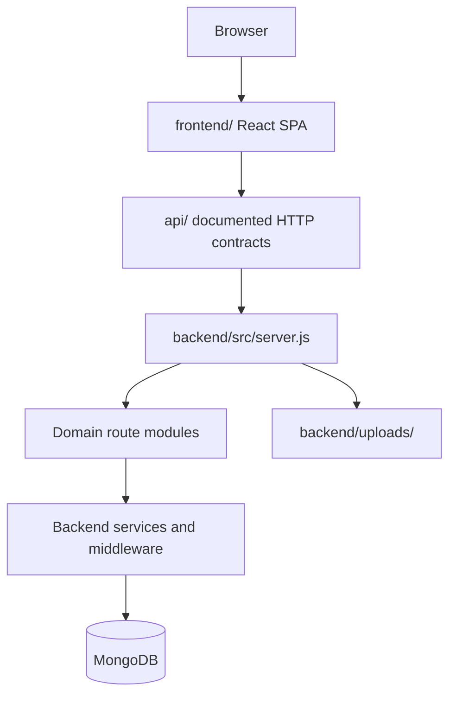

# CollegeOS — Architecture

## System Overview

CollegeOS is organized as one frontend, one backend modular monolith, one MongoDB database, and one API contract boundary.



## Responsibilities

- **`frontend/`** contains the only Vite/React application. `src/services/apiClient.ts` owns shared browser transport; React context and views consume it.
- **`backend/src/server.js`** loads configuration and starts the HTTP server. `app.js` composes middleware and domain route registration.
- **`backend/src/routes/`** groups the existing API handlers by authentication, administration, academics, calendar, materials, assignments, timetable, files, communication, notices, workflow, reporting, finance, admissions, examinations, attendance, profile, departmental and health.
- **`backend/src/middleware/`** contains backend authentication, role, and student-scope checks. These checks, not frontend visibility, remain authoritative.
- **`backend/src/services/`** contains authorization and audience resolution, file storage and upload policy, student provisioning, password policy, similarity and institutional email generation.
- **`backend/src/config/database.js`** owns the Mongoose connection. `backend/src/db.js` contains persistence helpers and bootstrap logic; `backend/src/models/` holds one Mongoose model per collection.
- **`api/`** documents the backend contract; it does not implement duplicate routes or business logic.

## Request Flow

```
1. Browser request → Vite dev server (dev) or static files (prod)
2. API calls → /api/* → Express (backend/src/app.js)
3. CORS + JSON body parsing
4. Route registration order (app.js:58-82):
   health → auth → administration → academics → calendar → materials →
   assignments → lms → quizzes → timetable → myTimetable → files →
   notices → communication → workflow → reporting → finance →
   admissions → examinations → profile → departmental → attendance
5. Middleware chain per route:
   requireAuth → requirePermission/requireRole/requireStudentScope → handler
6. Handler uses services (accessControl, fileStorage, gradingService, etc.)
7. Mongoose models → MongoDB
8. Response → structured JSON (errors via toErrorResponse in utils/apiError.js)
```

## Frontend-to-Backend Communication

- **API base:** `VITE_API_BASE_URL` (default `http://localhost:4000/api`)
- **Auth:** Bearer token in `Authorization` header (stored in `localStorage.collegeos_token`)
- **Client:** `frontend/src/services/apiClient.ts` — `apiFetch` + `apiRequest` + `ApiError`
- **LMS wrapper:** `frontend/src/services/lmsApi.ts` — typed functions for every LMS endpoint
- **State:** `CollegeOSContext.tsx` — global React context with auth handlers, master data cache, UI actions

## Data Access Patterns

- **Models:** One Mongoose model per collection in `backend/src/models/`
- **Bootstrap:** `backend/src/db.js:seedBaseUsers()` provisions only the Super Admin
- **Demo fixtures:** `scripts/seed-demo.js` (opt-in, development only)
- **Audience targeting:** `Audience` model + `accessControl.js` resolves visibility from session user
- **File storage:** `backend/uploads/` with subdirectories per module; served via `/api/files/:id` with entitlement check

## Existing Integrations

- **Nepali calendar:** `nepali-date-converter` + custom `frontend/src/lib/nepaliCalendar.ts`
- **Password policy:** `backend/src/services/passwordPolicy.js` + frontend `passwordPolicy.ts`
- **Similarity/AI:** `@google/genai` for plagiarism detection (assignments)
- **QR codes:** `qrcode` + `html5-qrcode` for attendance check-in
- **3D campus:** `@react-three/fiber`, `@react-three/drei`, `three` (landing page)
- **Real-time:** `socket.io` + `socket.io-client` (not fully utilized)
- **File uploads:** `multer` with magic-byte validation

## Architectural Limitations

1. **Tenant isolation incomplete** — institution identifiers not enforced across every collection and query. Do not deploy as multi-institution service.
2. **Forgot-password** — no email delivery; reset token stored but not issued (`501` response).
3. **Academic calendar workspace** — API complete but UI renders timetable/exam data instead of calendar events.
4. **Object storage** — local disk only (`backend/uploads/`), no S3/cloud abstraction.
5. **Library circulation** — `library.view` permission exists but borrowing/fines logic not implemented.
6. **PDF transcripts** — `Document` model accepts `TRANSCRIPT` type but no generator endpoint.
7. **SSO/OAuth** — email/password only; no Google Workspace or SAML integration.
8. **Biometric/QR hardware** — attendance QR is software-only; no terminal fleet sync.

## Verification

`npm test` runs the MongoDB-backed API integration suite (`backend/tests/api.test.js`) and the Nepali calendar unit tests. The API suite exercises the real persistence, authorization and upload pipeline against a dedicated test database, covering the login/session lifecycle, account provisioning, admissions through enrolment, curriculum and section management, calendar audience visibility, learning materials, assignments, submissions and marking, timetable conflict handling, and file entitlement checks — including the negative case for each rule.

## Production Configuration

Configure `MONGODB_URI`, `JWT_SECRET`, `COLLEGEOS_BOOTSTRAP_ADMIN_PASSWORD` and `INSTITUTION_EMAIL_DOMAIN` in the environment (root `.env` is loaded by both the backend and the dev orchestrator; `backend/.env` is a local copy). Never expose secrets through `VITE_*`. Bootstrap credentials are created only if the configured administrator does not already exist; changing the bootstrap password setting does not reset an existing account.